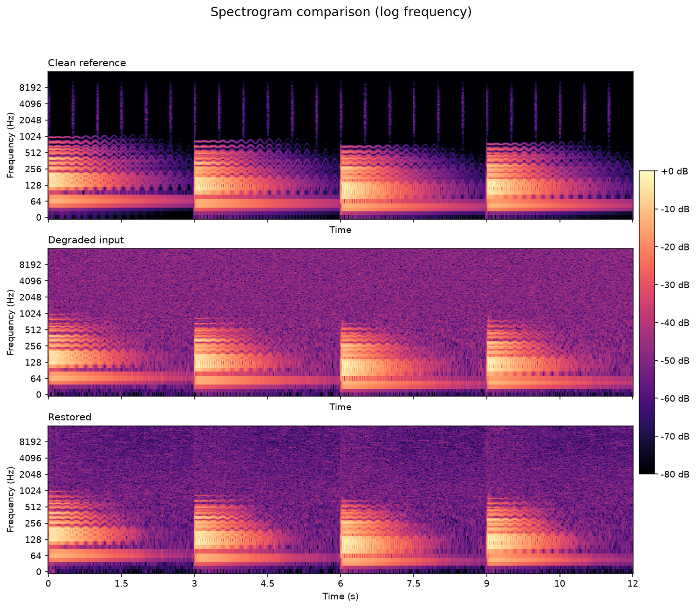

# Audio Restoration for MusicGen Outputs

<div align="center">


[](https://colab.research.google.com/github/Alessandro1040/ID-2-Audio-Restoration-for-Generative-Models-Improving-MusicGen-Outputs/blob/main/audio_restoration.ipynb)

**Machine Learning Project 2024/2025 - Sapienza University of Rome**  
*Project ID 2: Audio Restoration for Generative Models*

</div>

---

## Overview

This repository contains a **zero-shot, reference-free restoration pipeline** for
audio produced by generative music models such as MusicGen. It post-processes a
track without changing its musical content and without requiring a clean target.

The current implementation is a rewrite of the first release. The first version
used an aggressive "anti-vocal" gate and two passes of spectral subtraction; on
the project's own degraded test clip those stages removed most of the music and
made the objective score strongly negative. The rewrite replaces them with a
decision-directed Wiener filter, a proper limiter, and a measurement harness.
The important design choices are:

- **Preserve the source format.** Sample rate and channel layout are kept by
  default (MusicGen outputs 32 kHz); the old code silently forced 44.1 kHz mono.
- **Remove noise, not music.** Noise is estimated per frequency bin from quiet
  frames, the gain floor is shallow in the low band (where the music lives) and
  strict above 4 kHz (where hiss and codec noise live), and a perceptual gate
  driven by the smoothed posterior SNR closes the bins that the Wiener gain
  leaves open after a loud passage.
- **Protect transients.** Spectral onsets temporarily raise the gain so drum and
  piano attacks are not softened. The boost is weighted by the posterior SNR, so
  an onset cannot reopen a bin that contains nothing but noise.
- **Let the user decide about the voice.** `keep`, `reduce` and `remove` map to
  0 %, 55 % and 130 % of a Demucs vocal stem. The over-subtraction in `remove`
  cancels the small amount of voice that Demucs leaves in the other stems.
- **Clean noise-only silence.** A separate gate zeroes frames whose broadband
  energy is below the estimated noise floor, in every preset. Sustained musical
  passages keep the full hold/release, so note tails decay naturally; isolated
  clicks and background words get a much shorter fade instead of becoming half
  a second of residual noise. A per-bin tonal detector also keeps a piano or
  guitar note open while its harmonics are still above the floor, even after
  the broadband level has fallen below the gate threshold.
- **Measure every claim.** The demo and evaluation scripts report SI-SDR, SNR,
  segmental SNR, LSD and reference-free descriptors with explicit directions.
- **Be honest about the result.** This is a post-processor, not a neural
  bandwidth extension or a remastering model.

---

## Quick Start

### Install

Core dependencies are enough to run the restoration, demo and evaluation:

```bash
python -m venv .venv
source .venv/bin/activate          # Windows: .venv\Scripts\activate
pip install -r requirements.txt
```

`requirements.txt` contains only the five core packages. Install
`requirements-optional.txt` for PESQ/STOI, Demucs vocal separation, and the
MusicGen/download helpers; the evaluation CLI automatically omits PESQ and STOI
when they are not installed. Without Demucs the vocal modes still work on stereo
files through the mid/side fallback, but separation is much less precise.

### Web demo

```bash
pip install -r requirements-web.txt   # adds Flask, only needed for the site
python app.py
```

Open **http://127.0.0.1:7865/**. The page accepts WAV, MP3, FLAC, OGG, M4A,
AIFF and other formats, restores the upload and plays the original and the
restored version side by side. The result is also available as a 24-bit WAV
download. The included example `examples/demo_dirty.wav` is the degraded clip
from `scripts/make_demo.py`, so no external audio download is required.

The page exposes two independent choices:

- **Voce nella traccia** — `Mantieni`, `Riduci` or `Rimuovi`. Choose `Rimuovi`
  when the voice is only background or when you want an instrumental. Demucs is
  used when installed; otherwise stereo files fall back to mid/side reduction.
- **Pulisci i momenti di solo rumore** — on by default and applied in every
  preset. Noise-only frames become exact digital zeros; note tails are kept and
  fade, while isolated blips use a short fade.

Uploads are stored temporarily in `webdemo/jobs/` and deleted after one hour.
Set `PORT` or `HOST` to change the bind address, e.g. `PORT=8000 python app.py`.
The demo is local-only by default and does not send audio to any external API.

### Reproduce the demo (no audio download required)

```bash
python scripts/make_demo.py
```

This synthesizes a short track, degrades it (8 kHz band limit, 12 dB SNR hiss,
8-bit quantization and clipping), restores it and writes:

```text
results/demo/clean.wav
results/demo/dirty.wav
results/demo/restored.wav
results/plots/waveforms_comparison.png
results/plots/spectrograms_comparison.png
results/plots/frequency_response.png
results/plots/pipeline_diagram.png
results/metrics/demo_results.json
```

### Restore a file or a folder

```bash
# One file; the output keeps the input sample rate and channels
python scripts/restore_audio.py output.wav -o restored/

# A whole MusicGen output folder, forced to 32 kHz mono at -16 LUFS
python scripts/restore_audio.py generated/ -o restored/ \
    --sample-rate 32000 --mono --target-lufs -16

# Conservative preset, no tonal EQ
python scripts/restore_audio.py output.wav -o restored/ \
    --preset gentle --no-eq
```

The default output is 24-bit WAV named `restored_<input>.wav`. A JSON report is
written to `restored/restoration_report.json` (use `--report` to change it).

### Evaluate a dirty/clean pair

```bash
python scripts/evaluate.py \
    --original_dir data/dirty \
    --restored_dir restored \
    --reference_dir data/clean \
    --output_csv results/metrics/evaluation_results.csv \
    --json results/metrics/evaluation_summary.json
```

Without `--reference_dir` the script still reports reference-free descriptors
(noise floor, clipping, spectral flatness, loudness, true peak, ...). With a
clean reference it adds SI-SDR, SNR, segmental SNR, LSD and, if installed, PESQ
and STOI.

---

## Measured Results

Unless marked otherwise, the numbers below were produced by the code in this
repository. Lower-is-better metrics are marked with `↓`, higher-is-better with
`↑`.

### Synthetic demo (`python scripts/make_demo.py`, default `music` preset)

| Metric | Degraded | Restored | Change |
|---|---:|---:|---:|
| SI-SDR ↑ | 11.82 dB | **19.84 dB** | **+8.02 dB** |
| SNR ↑ | 12.03 dB | **19.87 dB** | **+7.84 dB** |
| Segmental SNR ↑ | 0.44 dB | **9.90 dB** | **+9.47 dB** |
| LSD ↓ | 38.42 dB | **8.83 dB** | **−29.59 dB** |
| Noise floor ↓ | −28.93 dBFS | **−64.65 dBFS** | **−35.72 dB** |
| Clipping ↓ | 0.114 % | **0.000 %** | repaired |
| Spectral flatness ↓ | 0.318 | **0.0004** | matches the 0.0005 of the clean reference |
| True peak (neutral) | +0.25 dBTP | −1.00 dBTP | limited |
| Integrated loudness (neutral) | −18.09 LUFS | −15.81 LUFS | not normalized to a target |

The demo also confirms that the restoration preserves the 32 kHz sample rate,
removes all flat-topped clipping runs, and reports a positive limiter reduction
instead of a negative "improvement".

The residual is not just low on average: on the 5 % quietest frames of the clean
reference (whose own level is −55.8 dBFS) the degraded input sits 26.9 dB
*above* the reference while the restored output sits 7.1 dB *below* it, i.e. the
noise is gone rather than merely buried. In the quietest second of the restored
demo the 1–16 kHz residue sits around −107 dBFS, roughly 65 dB below the music,
and the sub-bass shoulder is at −78 dBFS.

### Real-music stress test (4 excerpts, 20 s each)

> These numbers were measured with the previous tuning. The denoiser in the
> current revision uses a stricter noise estimate and the new SNR gate, so
> re-running `scripts/evaluate.py` on your own excerpts will give different
> (typically lower-residue) values.

Degradation: 12 dB SNR broadband hiss, 8-bit quantization and an 8 kHz band
limit. The clean excerpt was the decoded source; the default `music` preset was
used. This is a proxy for MusicGen failures, not a substitute for a large
MusicGen benchmark.

| Metric | Degraded | Restored | Mean change |
|---|---:|---:|---:|
| SI-SDR ↑ | 11.06 dB | **13.35 dB** | **+2.29 dB** |
| SNR ↑ | 11.31 dB | **13.51 dB** | **+2.20 dB** |
| Segmental SNR ↑ | 9.23 dB | **12.08 dB** | **+2.85 dB** |
| LSD ↓ | 13.27 dB | **8.35 dB** | **−4.92 dB** |
| Noise floor ↓ | −17.76 dBFS | **−22.30 dBFS** | **−4.54 dB** |
| Spectral flatness ↓ | 0.117 | **0.033** | **−0.083** |

The improvement is smaller than on the synthetic clip because real mixes are
dense and already contain broadband content that overlaps the noise estimate.
The pipeline is deliberately conservative: it does not attempt to recreate
missing high frequencies or to make a loud master by default.

---

## Pipeline

```text
input
  │
  ├─ declip (short flat-topped runs only, optional)
  ├─ mains-hum detection and notching (optional)
  ├─ vocal handling: keep / reduce / remove (Demucs, optional)
  ├─ noise-only detector (runs on the optionally vocal-free signal)
  ├─ decision-directed Wiener denoising
  │     per-bin noise estimate, transient protection, frequency-dependent
  │     floor, smoothed-SNR noise gate
  ├─ high-pass (optional; 80 Hz for the voice preset)
  ├─ tonal EQ: low shelf, presence peak, air shelf (optional)
  ├─ silence gate: exact zeros for noise-only frames, short fade for blips
  ├─ feed-forward compressor (optional; voice preset)
  ├─ loudness target + look-ahead limiter (optional; -1 dBTP ceiling)
  ├─ TPDF dither only when writing 16-bit PCM
  └─ silence gate re-applied so muted regions stay exact zeros
output: same sample rate and channel layout as the input
```

Long files are processed in overlapping 120 s blocks so memory use stays
bounded. The mask is estimated from the average power of all channels and then
applied to each channel, which keeps the stereo image coherent.



*The demo: the broadband haze of the degraded input is reduced while the
harmonic lines and percussion hits remain visible.*

### Presets

| Preset | Intended use | Main differences |
|---|---|---|
| `music` | Default for MusicGen instrumental output | balanced denoising, silence gate at 4.5 dB, subtle EQ, no loudness target |
| `gentle` | Already-clean or valuable sources | 55 % denoise strength, shallow floors, silence gate at 6 dB, minimal EQ |
| `strong` | Noisy, hissy or low-bitrate sources | deeper low-band floor, silence gate at 5 dB (more aggressive than `music`), stronger shelves |
| `voice` | Speech and podcasts | 80 Hz high-pass, silence gate at 4.5 dB, compression, hum removal, −16 LUFS target |

In every preset `clean_silence=True` by default. The gate uses a 200–300 ms
hold and a smooth release for sustained music; isolated blips get a 40/60 ms
hold/release so they disappear instead of being stretched into residual noise.
The per-bin tonal detector uses `silence_tonal_snr_db=14` in every preset (white
and pink noise stay around 3 dB, so they are still muted); set it to `None` to
disable it. Isolated tonal events use a 250 ms fade
(`silence_tonal_isolated_release_ms`) instead of the 60 ms blip fade, so a single
quiet piano note still rings out.

Use `--strength`, `--highpass`, `--target-lufs`, `--no-denoise`, `--no-declip`,
`--no-eq` and `--no-normalize` to override a preset from the CLI.

---

## Python API

```python
import soundfile as sf
from src import AudioRestorer, AudioQualityMetrics

restorer = AudioRestorer(preset="music", verbose=True)

# File in, file out; returns a JSON-serializable report
report = restorer.restore_file("input.wav", "restored.wav")
print(report["loudness"])

# In-memory use
audio, sr = sf.read("input.wav", always_2d=True)
restored, report = restorer.restore_array(audio, sr)

# Objective evaluation when a clean reference exists
metrics = AudioQualityMetrics(sample_rate=32000)
original, after, deltas = metrics.compare_files(
    "input.wav", "restored.wav", reference_path="clean.wav")
metrics.print_comparison(original, after, deltas)
```

Custom configuration:

```python
from src import AudioRestorer, RestorationConfig

config = RestorationConfig.from_preset(
    "music",
    denoise_strength=0.8,
    target_lufs=-16.0,
    true_peak_db=-1.0,
    vocals="remove",       # keep / reduce / remove
    clean_silence=True,    # exact zeros in noise-only frames
    silence_tonal_snr_db=14.0,  # keep quiet harmonic note tails
    silence_tonal_isolated_release_ms=250.0,  # ring-out for single notes
)
restorer = AudioRestorer(config=config)
```

The old class name `AggressiveAudioRestorer` and the old `restore()` method are
still available as compatibility aliases, but new code should use
`AudioRestorer` and `restore_file()` / `restore_array()`.

---


## CLI Reference

### `scripts/restore_audio.py`

| Option | Meaning |
|---|---|
| `-o`, `--output-dir` | Output folder (required) |
| `--preset` | `music`, `gentle`, `strong` or `voice` |
| `--strength` | Denoising strength, 0–1.5 |
| `--sample-rate` | Resample the output; default preserves the input |
| `--bit-depth` | `16`, `24` (default) or `32` (float) |
| `--mono` | Downmix to mono |
| `--target-lufs` | Optional loudness target, e.g. `-14` or `-16` |
| `--true-peak-db` | Limiter ceiling (default `-1.0`) |
| `--highpass` | High-pass cutoff in Hz |
| `--vocals` | `keep`, `reduce` or `remove` the Demucs vocal stem |
| `--hum` / `--no-hum` | Force or disable mains-hum removal |
| `--no-silence-clean` | Disable the noise-only gate |
| `--no-denoise`, `--no-declip`, `--no-eq`, `--no-normalize` | Disable a stage |
| `--suffix` | Prefix of output filenames (default `restored_`) |
| `--report` | JSON report path |
| `--no-overwrite`, `--quiet` | Batch-friendly behaviour |

`scripts/restore_audio` is a backwards-compatible wrapper for the old
extensionless entry point.

### `scripts/evaluate.py`

`--original_dir` and `--restored_dir` are required. `--reference_dir` enables
reference-based metrics, `--output_csv` writes one row per file/metric, and
`--json` writes a compact mean-delta summary. `--prefix` defaults to
`restored_`, matching the restoration CLI.

### `python -m src.restoration`

A minimal single-file entry point:

```bash
python -m src.restoration input.wav output.wav --preset music --report report.json
```

---

## Metrics and Their Directions

| Metric | What it measures | Better |
|---|---|---|
| SI-SDR | Scale-invariant signal-to-distortion ratio against a clean reference | higher |
| SNR | Reference-to-error energy ratio after level alignment | higher |
| Segmental SNR | Frame-wise SNR, clamped to [−10, 35] dB | higher |
| LSD | Log-spectral distance in the 200 Hz–7 kHz band | lower |
| Noise floor | 10th percentile of short-frame RMS | lower |
| Clipping | Percentage of samples at or above 0.999 | lower |
| Spectral flatness | How noise-like the spectrum is (0 = tonal, 1 = flat) | lower |
| Dynamic range, centroid, bandwidth, roll-off, THD | Descriptive; no single direction | neutral |
| Integrated loudness, true peak | Delivery/level descriptors | neutral |

PESQ and STOI are optional and are **speech** metrics; they are reported only
when the packages are installed and should not be treated as ground truth for
music. The evaluation CLI always shows the direction and verdict so a
lower-is-better change is never presented as an improvement.

---

## Repository Structure

```text
.
├── app.py                           # Entry point for the local web demo
├── audio_restoration.ipynb          # Short walkthrough of the new pipeline
├── requirements.txt                 # Core: numpy, scipy, librosa, soundfile, matplotlib
├── requirements-optional.txt        # PESQ/STOI, MusicGen, yt-dlp
├── requirements-web.txt             # Flask, only for the local demo site
├── LICENSE
├── README.md
├── docs/
│   └── spectrograms_comparison.png  # Demo figure used above
├── examples/
│   ├── README.md
│   └── demo_dirty.wav               # Small example used by the web demo
├── webdemo/
│   ├── app.py                       # Flask API and page routes
│   ├── templates/index.html         # Demo page
│   └── static/                      # CSS and JavaScript
├── src/
│   ├── __init__.py                  # Public, lazily imported API
│   ├── dsp.py                       # STFT denoiser, filters, silence gate, limiter
│   ├── restoration.py               # AudioRestorer + presets + CLI
│   ├── vocals.py                    # Optional Demucs / mid-side vocal handling
│   ├── metrics.py                   # Reference-based and reference-free metrics
│   └── demo.py                      # Synthetic music generator and corruption
├── tests/
│   └── test_silence.py              # Gate, exact zeros and preset defaults
├── scripts/
│   ├── restore_audio.py             # Batch/single-file restoration CLI
│   ├── restore_audio                # Compatibility wrapper
│   ├── make_demo.py                 # Demo audio, figures and metrics
│   ├── evaluate.py                  # Batch evaluation CLI
│   ├── generate_audio.py            # Optional MusicGen example (needs audiocraft)
│   └── download_test_samples.py     # Optional yt-dlp helper
└── results/                         # Generated locally; ignored by git
    ├── demo/
    ├── metrics/
    └── plots/
```

---

## Limitations

- The denoiser assumes that the quietest frames are a reasonable estimate of
  stationary noise. Strongly non-stationary noise (traffic, audience, overlapping
  speech) is only partially attenuated.
- Background speech is not the same as a sung vocal stem. Demucs handles the
  latter well; distant chatter that the model classifies as `other` can survive
  `vocals="remove"`. The silence gate shortens isolated blips, but the clean
  solution is a source where the background is actually silent.
- Declipping repairs short flat-topped runs (up to 8 ms and 5 % of samples).
  Heavily clipped audio is left untouched because interpolation would invent
  content.
- There is no learned bandwidth extension. A source that was generated or
  encoded with an 8 kHz limit remains band-limited; the EQ only shapes what is
  present.
- The default `music` preset does not change loudness. Use `--target-lufs` when
  you need a delivery level.
- SI-SDR and LSD can punish intentional tonal changes. Always inspect the
  reference-free descriptors and listen before declaring a regression.
- The real-music numbers above use artificial degradations. A large-scale
  MusicGen listening test is future work, and the demo generator is a smoke
  test, not a benchmark.

---

## Reproduce the Reported Numbers

```bash
# Synthetic demo and JSON metrics
python scripts/make_demo.py

# Inspect the saved report
python - <<'PY'
import json
report = json.load(open("results/metrics/demo_results.json"))
print(report["metrics"]["improvements"]["SI-SDR (dB)"])
PY

# Optional real-file evaluation: create dirty/clean folders, then
python scripts/restore_audio.py data/dirty -o restored/
python scripts/evaluate.py --original_dir data/dirty --restored_dir restored/ \
    --reference_dir data/clean --json results/metrics/summary.json
```

You can also run the small self-tests without any files:

```bash
python -m pytest -q
python -m src.metrics
python -m src.restoration --help
```

---

## Academic Context

**Course:** Machine Learning 2024/2025<br>
**University:** Sapienza University of Rome<br>
**Instructor:** Prof. Emanuele Rodolà<br>
**Project type:** Research implementation (ID 2)

The project addresses post-hoc quality improvement for generative audio without
changing its semantic content. The rewrite focuses on reproducible measurement
and on avoiding the failure mode of the first release: removing music while
claiming to remove noise.

---

## License

MIT License - see [LICENSE](LICENSE).

## Acknowledgments

- Prof. Emanuele Rodolà for project guidance
- Meta AI for the MusicGen model and the motivation for this work
- The open-source audio-processing community (librosa, SciPy, soundfile,
  Matplotlib)
